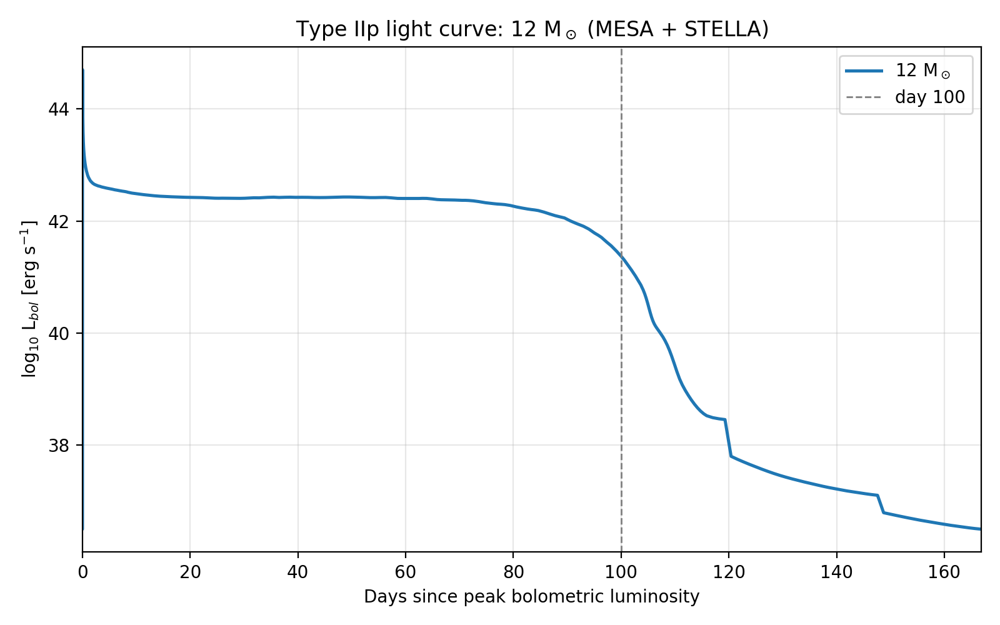
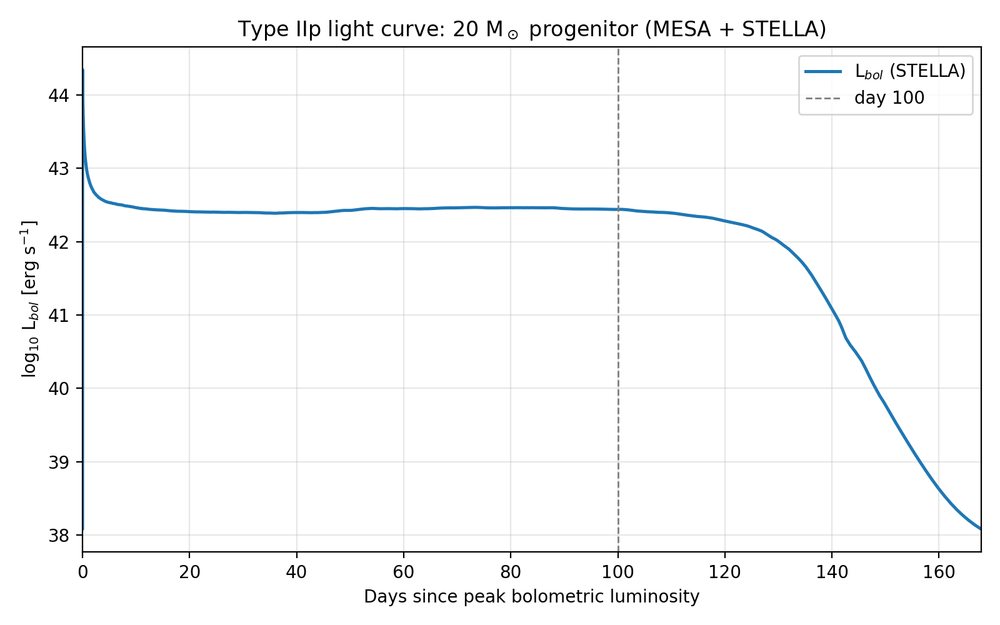
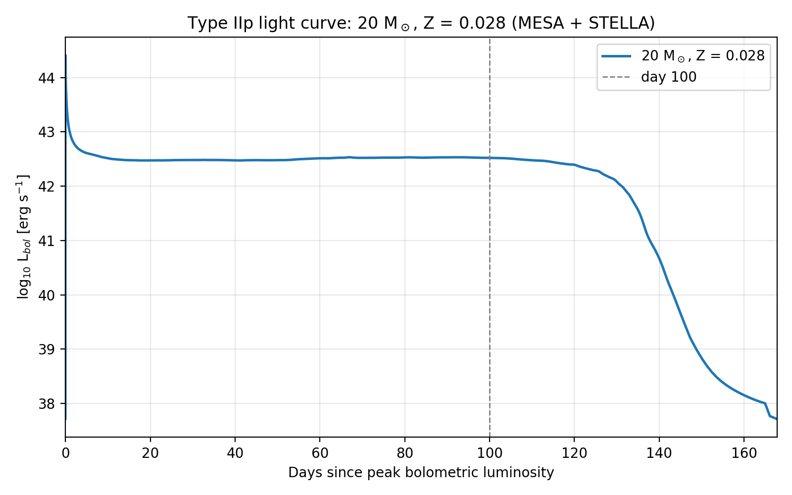
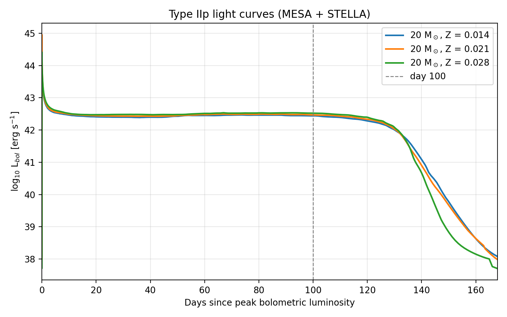
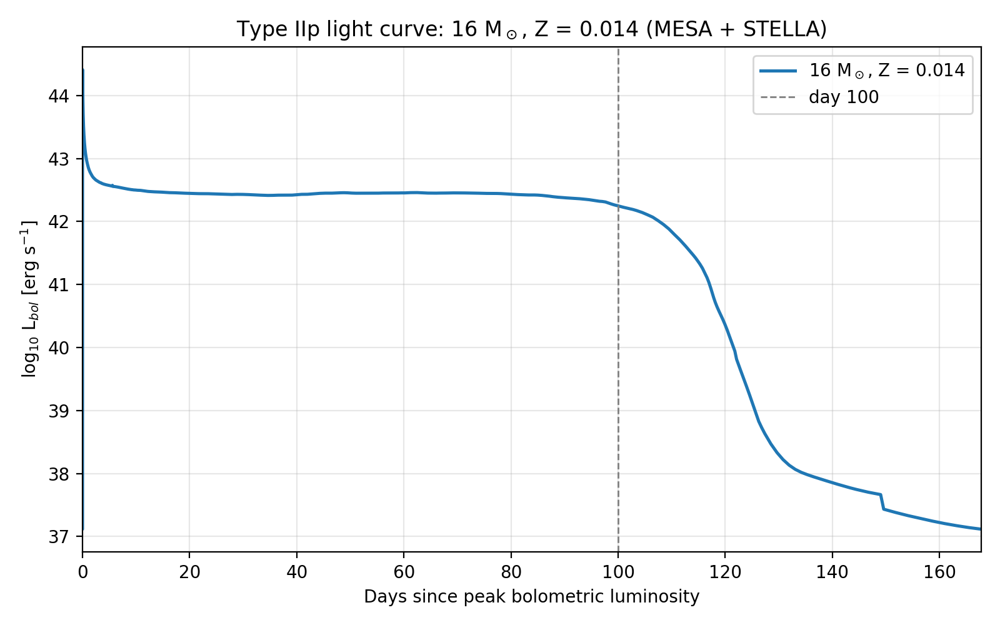
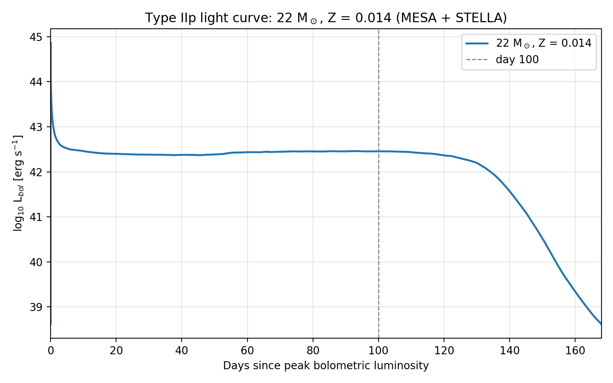
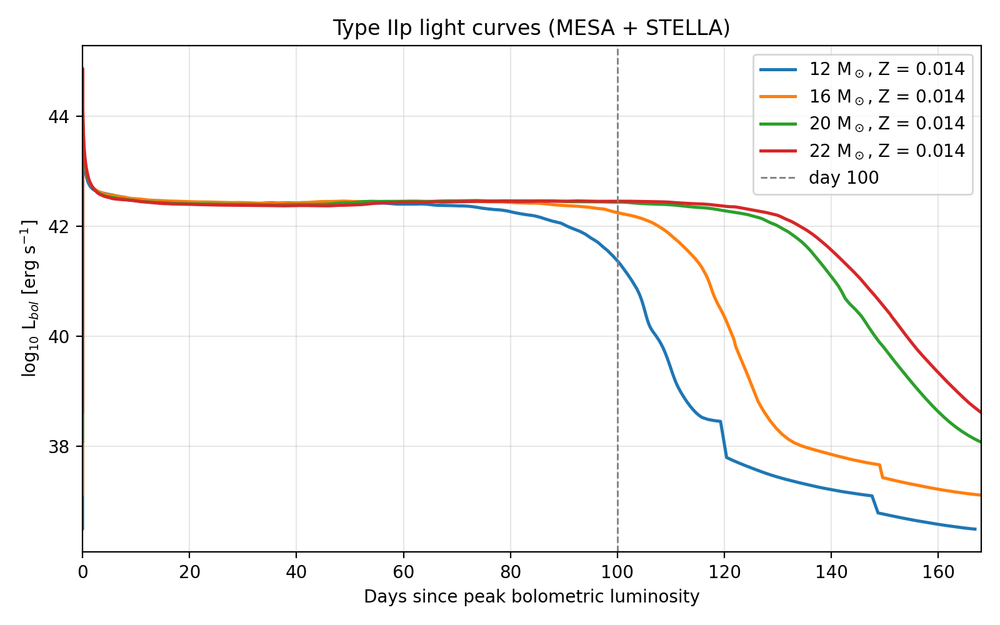
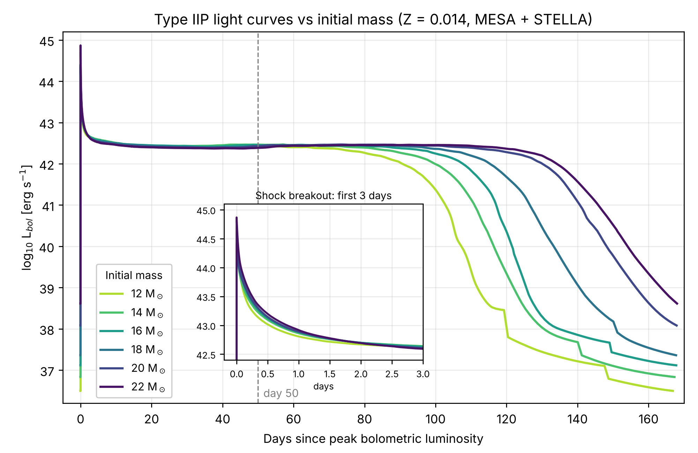
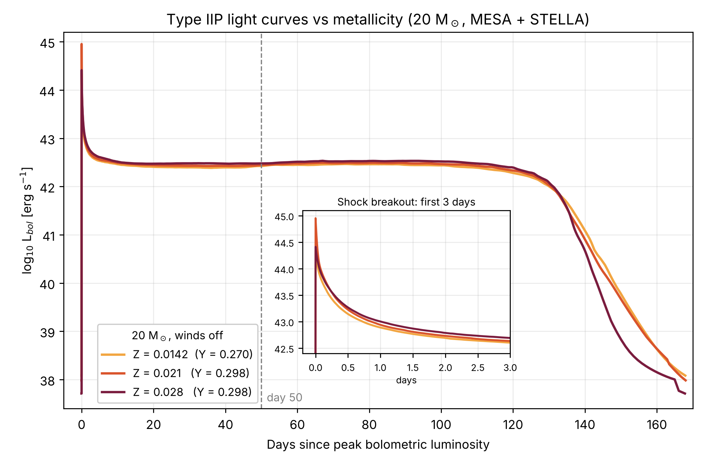

# MESA Supernova Lab Book

Digital lab book for the project, one section per session.

## Project Overview

### Modelling Supernovae with the MESA Stellar Code
Digital lab book
Authors: James Higgins and Blake Nimmo
Supervisor: Pablo-Loren Aguilar

### Aim
Use the MESA stellar evolution code to simulate the life cycle of massive stars from the pre-main sequence up to the point just before core collapse. The saved pre-collapse model is then used as the starting point for a second MESA simulation of the supernova explosion (the collapsing iron core is removed and energy is injected to launch a shock through the star). The model just before shock breakout is passed to STELLA, which calculates the light curve for roughly the first 170 days after the explosion.

### Software
- MESA (Modules for Experiments in Stellar Astrophysics), version r26.4.1, installed following the official instructions at https://mesastar.org
- MESA SDK (installed in /Applications/mesasdk)
- STELLA (radiation hydrodynamics code supplied with MESA, in mesa/stella) for the light curves
- Python with numpy and matplotlib for plotting

### Standard physics settings (all runs unless stated)
- Metallicity Z = 0.0142, helium Y = 0.2703 (Asplund et al. 2009 solar values)
- Winds off (Dutch_scaling_factor = 0), no rotation
- Explosion energy: set by the ccsn_IIp test case (thermal bomb, total energy ≈ 8 × 10^50 erg after injection)
- ⁵⁶Ni mass set to 10⁻¹⁵ M☉ (effectively zero) → light curves have a plateau but no radioactive tail

### Progress by star
- 20 M☉ (Z = 0.0142): pre-collapse model complete (28/09). Explosion stalled in shock part 5 (02/10); fixed by rerunning part 5 only (05/10). Light curve complete (05/10).
- 12 M☉ (Z = 0.0142): pre-collapse model complete (02/10). Explosion and light curve complete (05/10). Lightest star in the study, since lower-mass stars take too long to simulate.
- 20 M☉, Z = 0.028: pre-collapse, explosion and light curve complete (07/10–08/10).
- 20 M☉, Z = 0.021: pre-collapse complete (09/10). Explosion stalled just before shock breakout; STELLA run from the last saved model (10/10). Light curve complete.
- 16 M☉ (Z = 0.0142): pre-collapse, explosion and light curve complete (12/10–13/10).
- 22 M☉ (Z = 0.0142): pre-collapse run started (16/10).
- Planned: 14 M☉ and 18 M☉.

---

## 25/09 (AM): Installing MESA

### Aim
Install MESA and get it running.

### What we did
Downloaded and installed MESA (version r26.4.1) and the MESA SDK, carefully following the instructions on the official website (https://mesastar.org). MESA is in ~/Downloads/mesa and the SDK in /Applications/mesasdk.

Every new terminal window needs these lines before MESA will run (or add them once to ~/.zshrc so they run automatically):

```
export MESASDK_ROOT=/Applications/mesasdk
source $MESASDK_ROOT/bin/mesasdk_init.sh
export MESA_DIR=~/Downloads/mesa
export OMP_NUM_THREADS=4
```

If MESA_DIR is not set, ./mk and ./rn fail with errors like "/star/work_standard_makefile: No such file or directory".

### Notes
MESA will be our main tool for this experiment. The plan is to simulate a star's life cycle from the pre-main sequence until it is just about to collapse. This creates a save point just before collapse, which we then use to run a second simulation of the explosion, followed by STELLA to produce the light curve over the following ~170 days.

---

## 25/09 (PM): Getting familiar with MESA

### What we did
Following a discussion with Pablo at the end of the morning session, we spent the afternoon learning the ins and outs of MESA and how it works, so that we are familiar with the software before starting our simulations next week.

Every MESA run follows the same pattern, run from inside the run folder:

```
./clean    # remove old compiled files
./mk       # compile
./rn       # run every stage listed in the rn script
```

- Settings are in the inlist files; each stage loads the .mod file saved by the stage before it.
- Plots (PGPLOT) are saved as images in the png/ folder; history and profile data go in LOGS folders.
- Long runs: keep the Mac awake from a second terminal tab with `caffeinate -dims` (stop with Control+C), and keep it plugged in with the lid open.

### Next steps
Start running the stellar evolution simulations next week.

---

## 28/09: 20 M☉ star to pre-collapse

### Aim
Simulate the life cycle of a 20 M☉ star up to the point just before it collapses.

### Method
Used the preset folder 20M_pre_ms_to_core_collapse from MESA's test suite (mesa/star/test_suite), with guidance from the MESA website.

Mass and composition are set in inlist_mass_Z_wind_rotation:

```
new_Z = 1.42d-2
Zbase = 1.42d-2
initial_mass = 20
initial_z = 1.42d-2
initial_y = 0.2703d0
Dutch_scaling_factor = 0d0      ! winds off
```

Run with:

```
cd ~/Downloads/mesa/star/test_suite/20M_pre_ms_to_core_collapse
./clean
./mk
./rn
```

The run goes through: late pre-ZAMS → ZAMS → end of core He burning → (envelope-removal step, switched off) → end of core C burning → lgTmax → core collapse. The final model is saved as final.mod.

### Results
- The simulation reached the pre-collapse point smoothly, with no issues.
- Run time: just over 1 hour.
- Output: final.mod (pre-collapse model).

### Next Steps
Take the 12 M☉ star to pre-collapse.

---

## 02/10 (AM): 12 M☉ to pre-collapse

### Aim
Simulate a 12 M☉ star up to the point just before collapse, in the same way as the 20 M☉ star.

### Method
Used the preset folder 12M_pre_ms_to_core_collapse from MESA's test suite, run with ./clean, ./mk, ./rn as for the 20 M☉ star. Final model saved as final.mod.
Metallicity Z = 0.0142 (confirmed from the explosion run).
Helium and wind settings in this folder's inlist_mass_Z_wind_rotation match the 20 M☉ run (Y = 0.2703, Dutch_scaling_factor = 0).

### Results
The simulation completed, but took considerably longer than the 20 M☉ run.
This was expected, because lighter stars evolve much more slowly, so MESA needs many more timesteps.

### Decision
12 M☉ will be the lightest star we analyse in this experiment, because anything lighter would take too long to simulate efficiently.

### Next steps
Once the simulation had finished, we turned our attention to simulating the explosion and briefly researched the method before the session ended.

---

## 02/10 (PM): 20 M☉ core collapse

### Aim
Now that we have pre-collapse models for two different stars (20 M☉ and 12 M☉), start simulating the explosion.

### Method
Used the ccsn_IIp test case (mesa/star/test_suite/ccsn_IIp). As instructed by Pablo, the pre-collapse model is copied in and renamed pre_ccsn.mod, which the inlists already load:

```
cd ~/Downloads/mesa/star/test_suite
cp 20M_pre_ms_to_core_collapse/final.mod ccsn_IIp/pre_ccsn.mod
cd ccsn_IIp
./clean
./mk
./rn
```

The explosion runs in 8 stages, each saving a model for the next:
1. infall (finished_infall.mod): core collapses until the inner radius drops below 400 km
2. end of infall (ready_for_edep.mod): the collapsing core is cut out (it becomes the neutron star)
3. energy deposition (done_with_edep.mod): energy is injected at the inner edge (the "thermal bomb") to launch the explosion
4–8. shock parts 1–5 (shock_part1.mod to shock_part5.mod): the shock travels out through the star, with Rayleigh–Taylor mixing. Part 5 stops when the shock is 0.05 M☉ below the surface and writes mesa.hyd and mesa.abn, the input files for STELLA.

### What we did
Began by simulating the explosion of the 20 M☉ star, starting from the pre-collapse save point (28/09). The run went smoothly at first.

### Issue
Our first big issue of the experiment: partway through the simulation, the software stopped and reported that it could not create shock_part5.mod, the output of the 5th and final shock stage.

### Next Steps
Resolve the issue and finish the run next session.

---

## 05/10: First Light Curves Acquired

### Aim
Pick up the failed run from where it stopped, complete it, and run the explosion for the 12 M☉ star.

### What we did
**20 M☉:** reran shock part 5 only, starting from the saved shock_part4.mod. To do this, the earlier stages in the rn script were skipped by wrapping them in `if false; then ... fi`:

```
if false; then
do_one inlist_infall_header finished_infall.mod LOGS_part_infall
...
do_one inlist_shock_part4_header shock_part4.mod LOGS_part4
fi
do_one inlist_shock_part5_header shock_part5.mod LOGS_part5
```

Part 5 then completed in about 8 minutes, terminating when the shock reached 19.95 M☉ (0.05 M☉ below the surface).

**Light curve with STELLA:** STELLA reads mesa.hyd and mesa.abn from stella/modmake:

```
cd ~/Downloads/mesa/stella
cp ~/Downloads/mesa/star/test_suite/ccsn_IIp/mesa.hyd modmake/
cp ~/Downloads/mesa/star/test_suite/ccsn_IIp/mesa.abn modmake/
rm -f strad/run/stop      # STELLA quits straight away if this file exists
./rn
```

The STELLA rn script compiles STELLA, builds the starting model (eve), builds opacity tables (vladsf) and runs the light curve calculation (strad). Results go into stella/res; the bolometric light curve is in res/mesa.lbol_lnuc.txt (columns: days after peak, log L_bol, log L_nuc).

**12 M☉:** copied the working 20 M☉ explosion folder to a new folder, so the 20 M☉ results were kept, and put the 12 M☉ model in:

```
cd ~/Downloads/mesa/star/test_suite
cp -r ccsn_IIp ccsn_IIp_12M
cp 12M_pre_ms_to_core_collapse/final.mod ccsn_IIp_12M/pre_ccsn.mod
```

Hiccup: the copied folder still had the 20 M☉ .mod files and the edited rn (part 5 only), so the first attempt just reran the 20 M☉ part 5. Fixed by moving all old .mod files except pre_ccsn.mod into an old_mods/ folder, removing the `if false` / `fi` lines from rn, clearing the old LOGS_part* folders, then:

```
unset MESA_SKIP_OPTIONAL   # otherwise rn copies in pre-made "standard" models
./clean
./mk
./rn
```

The 12 M☉ explosion then ran cleanly from 16:34 to 18:32, followed by STELLA (as above, copying the 12 M☉ mesa.hyd and mesa.abn into modmake, after backing up the 20 M☉ ones).

**Keeping results separate:** after each STELLA run, the results folder is copied so the next run can't overwrite it:

```
cp -r res res_12M     # res_20M, res_20M_2Z, res_20M_1.5Z, res_16M in the same way
```

**Plotting:** plot_lightcurve.py (in Downloads) reads res_<run>/mesa.lbol_lnuc.txt and plots log L_bol against days since peak. Examples:

```
python plot_lightcurve.py 12          # one star  -> lightcurve_12M.png
python plot_lightcurve.py 12 20       # overlaid  -> lightcurve_12M_vs_20M.png
```

### Results
Light curves acquired for both 20 and 12 M☉ stars.
- Both plateaus sit at log L ≈ 42.4 (≈ 2.5 × 10⁴² erg/s), a normal Type IIP luminosity.
- The 12 M☉ plateau ends around day 85–100, the 20 M☉ around day 120–125, as expected, because plateau length grows with hydrogen envelope mass.
- No radioactive tail on either curve. Cause: the ⁵⁶Ni mass is set to effectively zero in inlist_shock_part5 (`x_ctrl(12) = 1d-15 ! amount of ni56 to add`); log L_nuc is only ≈ 10³⁹ erg/s. This applies to all our runs, so the plateau comparison is still valid. To discuss with Pablo whether a nickel tail is needed.
- The bumps and sudden steps on the 12 M☉ curve after the plateau (around days 105–108, 120 and 148) occur at 10³⁷–10³⁸ erg/s, about 10,000 times fainter than the plateau. They are most likely numerical (the photosphere crossing individual mesh zones), not physical. To discuss with Pablo.





### Next steps
Double the metallicity of the 20 M☉ star (Z = 0.0142 → 0.028) and run it again.

---

## 07/10: 0.028 Z star

### Aim
Double the metallicity of the 20 M☉ star and run it again.

### What we did
Initial run: Z = 0.0142, New run: Z = 0.028.
- Made a copy of the 20 M☉ pre-collapse folder (20M_Z0.028) and changed `new_Z`, `Zbase` and `initial_z` to 2.8d-2 in inlist_mass_Z_wind_rotation. Helium was also changed to `initial_y = 0.2979d0` (consistent with helium rising with metallicity, ΔY/ΔZ ≈ 2). Winds left off.
- Completed with no issues.

Ran explosion for increased metallicity star:
- New explosion folder ccsn_IIp_20M_2Z copied from ccsn_IIp_12M (which already had the full rn), with the 12 M☉ leftovers moved into old_12M/ and the new final.mod copied in as pre_ccsn.mod.
- MESA reported "using saved initial_z instead 0.028", confirming the right star was loaded.
- Ran overnight (22:53 → 03:30 on 08/10), then STELLA. Completed with no issues.

### Results
Correct data acquired for the double metallicity star up to collapse and explosion.
Plotted Z = 0.028 20 M☉ graph.



### Next steps
Simulate the Z = 0.021 star, and see Pablo about the bumpy 12 M☉ graph.

---

## 09/10 (AM): 0.021 Z star

### Aim
Simulate a 20 M☉ star with Z = 0.021 (1.5 × solar, halfway between the other two) up to collapse.

### What we did
Copied 20M_Z0.028 to 20M_Z0.021, moved the 0.028 outputs into old_Z0.028/, and changed the metallicity:

```
sed -i '' 's/2\.8d-2/2.1d-2/g' inlist_mass_Z_wind_rotation
```

Winds still off. Note: initial_y was left at 0.2979 (copied from the Z = 0.028 run). For consistency with the ΔY/ΔZ ≈ 2 scaling it should have been Y ≈ 0.284, so this run changes helium as well as Z. To mention in the write-up, or rerun with Y = 0.284.

Successfully ran the simulation to collapse (~1.5 hours).

### Results
Data up to collapse acquired (final.mod, all stages present).

### Next steps
Run the explosion in the PM session.

---

## 09/10 (PM): 0.021 Z star

### Aim
Run the explosion for the Z = 0.021 star.

### What we did
New explosion folder ccsn_IIp_20M_1.5Z (copied from ccsn_IIp_20M_2Z), with final.mod copied in as pre_ccsn.mod. MESA confirmed initial_z = 0.021.

**Issue:** stages 1–7 completed, but shock part 5 stalled just before shock breakout:
- timesteps fell to ~10⁻¹³ years and almost every step needed a retry (mostly "get_T_tau -- L <= 0", MESA struggling with the outermost cells)
- over ~6,000 models the star's age only advanced ~1 minute; the shock stayed at 19.883 M☉, never reaching the 19.95 M☉ target
- the trouble had already started at the end of part 4.

Attempts:
1. Changed the part 5 target to 0.15 M☉ below the surface (`x_ctrl(16) = 0.15`). MESA refused to start, because the shock was already at 19.890 M☉ at the start of part 5, past the new 19.85 target ("start_m > stop_m").
2. Changed to `x_ctrl(16) = 0.1` (target 19.90 M☉) and reran part 5 only:

```
bash -c 'source "$MESA_DIR/star/test_suite/test_suite_helpers"; do_one inlist_shock_part5_header shock_part5.mod LOGS_part5'
```

It stalled in the same way and stopped at max_model_number = 15000 (21:54), without saving shock_part5.mod.

**Solution (10/10):** MESA still wrote mesa.hyd and mesa.abn when it stopped. Checked them: 400 zones, no NaNs, energy conserved to ~10⁻¹⁶, shock in the outermost zones. Used these for STELLA. The handoff is therefore about 0.12 M☉ below the surface instead of the usual 0.05 M☉.

Plotted the light curve against the other metallicities.
- All Z variance data complete (0.0142, 0.021 and 0.028).

### Results
Z variance graph plotted
- Plateaus are almost identical (log L ≈ 42.4–42.5) and all end around day 120–130. Higher Z is very slightly brighter (≈ 0.05 dex, ~10%).
- Steeper luminosity drop-off after the plateau with larger Z.
- The effect of metallicity is small because winds are off: in real stars, Z mainly acts through wind mass loss (higher Z → more envelope lost → shorter, dimmer plateau). With winds off, every star keeps its full 20 M☉, so only the smaller effect of Z on opacity and structure remains.
- The Z = 0.021 breakout spike is the tallest, probably because of its earlier handoff to STELLA, not metallicity. The step at day ~165 on the Z = 0.028 curve is numerical. Tails are not meaningful (no ⁵⁶Ni).



### Next steps
Simulate more stars of varying mass to plot against our 12 M☉ and 20 M☉. Possible extension: repeat the metallicity series with winds on.

---

## 12/10: 16 M☉ star complete

### Aim
Simulate a 16 M☉ star, ideally all the way to the light curve, and plot it against the other masses.

### What we did
Simulated 16 M☉ star up to collapse:
- Copied the original 20M_pre_ms_to_core_collapse folder to 16M_pre_ms_to_core_collapse (so Z = 0.0142, Y = 0.2703, winds off, the same as the 20 M☉ and 12 M☉ runs), moved the 20 M☉ outputs into old_20M/, and changed only the mass:

```
sed -i '' 's/initial_mass = 20/initial_mass = 16/' inlist_mass_Z_wind_rotation
```

- Successful, no issues (about 1.5 hours).

Simulated explosion:
- Explosion folder ccsn_IIp_16M copied from ccsn_IIp_20M_2Z (standard part 5 target, x_ctrl(16) = 0.05), with final.mod copied in as pre_ccsn.mod.
- Successful, no issues

Plotted light curve (STELLA):
- Successful, no issues. Results saved in res_16M.

```
python plot_lightcurve.py 16          # 16 M☉ on its own
python plot_lightcurve.py 12 16 20    # mass comparison
```

### Results
Plotted 16 M☉ light curve.



### Next steps
Simulate more stars of varying mass. The plan has evolved to do 14 M☉, 18 M☉ and 22 M☉ (same settings, only initial_mass changed).
- 22 M☉ next session (pre-collapse run started 16/10 in 22M_pre_ms_to_core_collapse).

---

## 16/10 (AM): 22 M☉ to pre-collapse

### Aim
Simulate a 22 M☉ star up to the point just before collapse, in the same way as the other masses.

### What we did
Copied the original 20M_pre_ms_to_core_collapse folder to 22M_pre_ms_to_core_collapse (Z = 0.0142, Y = 0.2703, winds off, the same as the 12, 16 and 20 M☉ runs), moved the 20 M☉ outputs into old_20M/, and changed only the mass:

```
cd ~/Downloads/mesa/star/test_suite
cp -r 20M_pre_ms_to_core_collapse 22M_pre_ms_to_core_collapse
cd 22M_pre_ms_to_core_collapse
mkdir old_20M
mv *.mod LOGS photos png old_20M/ 2>/dev/null
sed -i '' 's/initial_mass = 20/initial_mass = 22/' inlist_mass_Z_wind_rotation
unset MESA_SKIP_OPTIONAL
./clean
./mk
./rn
```

- Successful, no issues. Run time: ~1.5 hours

### Results
Data up to collapse acquired (final.mod).

### Next steps
Run the explosion and STELLA light curve for the 22 M☉ star in the PM session.

---

## 16/10 (PM): 22 M☉ core collapse

### Aim
Run the explosion for the 22 M☉ star, calculate its light curve with STELLA, and plot it against the other masses.

### What we did
Simulated explosion:
- Explosion folder ccsn_IIp_22M copied from ccsn_IIp_20M_2Z (standard part 5 target, x_ctrl(16) = 0.05), with the old outputs moved out and final.mod copied in as pre_ccsn.mod:

```
cd ~/Downloads/mesa/star/test_suite
cp -r ccsn_IIp_20M_2Z ccsn_IIp_22M
cd ccsn_IIp_22M
mkdir -p old_20M_2Z
mv *.mod LOGS LOGS_part* mesa.hyd mesa.abn photos png old_20M_2Z/ 2>/dev/null
mkdir png
cp ../22M_pre_ms_to_core_collapse/final.mod pre_ccsn.mod
unset MESA_SKIP_OPTIONAL
./clean
./mk
./rn
```

- MESA reported initial_z = 0.0142 at the start, confirming the right model was loaded.
- Stages 1–7 completed, but shock part 4 stalled near the surface: the shock stopped at 21.879 M☉, just short of part 4's target of 21.89 M☉ (22.00 − 0.11, set by `x_ctrl(16) = 0.11` in inlist_shock_common). Timesteps fell to ~10⁻⁵ s with 1,805 retries, and the run hit max_model_number = 15000 after 159 minutes without saving shock_part4.mod. This is the same near-surface problem as the Z = 0.021 run; the larger envelope of the 22 M☉ star means the shock reaches it one stage earlier.
- Fix: moved both finish lines inside the stall point and reran parts 4 and 5 only, starting from the saved shock_part3.mod:

```
mv LOGS LOGS_failed_part4
# part 4: add its own target, 0.16 Msun below the surface (21.84 Msun)
perl -pi -e 's/^(\s*x_integer_ctrl\(1\) = 4.*)$/$1\n      x_ctrl(16) = 0.16/' inlist_shock_part4
# part 5: 0.13 Msun below the surface (21.87 Msun) instead of 0.05
sed -i '' 's/x_ctrl(16) = 0.05/x_ctrl(16) = 0.13/' inlist_shock_part5
bash -c 'source "$MESA_DIR/star/test_suite/test_suite_helpers"; do_one inlist_shock_part4_header shock_part4.mod LOGS_part4 && do_one inlist_shock_part5_header shock_part5.mod LOGS_part5'
```

- Both stages then finished cleanly (part 5 ended at 23:07 with the shock at 21.873 M☉ and 0 retries), writing shock_part5.mod, mesa.hyd and mesa.abn. The model is handed to STELLA 0.13 M☉ below the surface, compared with 0.05 M☉ normally and ~0.12 M☉ for Z = 0.021.

Plotted light curve (STELLA):

```
cd ~/Downloads/mesa/stella
cp ~/Downloads/mesa/star/test_suite/ccsn_IIp_22M/mesa.hyd modmake/
cp ~/Downloads/mesa/star/test_suite/ccsn_IIp_22M/mesa.abn modmake/
rm -f strad/run/stop
./rn
cp -r res res_22M
```

- Successful, no issues. Results saved in res_22M.

Added a 22 M☉ label to plot_lightcurve.py and plotted:

```
python plot_lightcurve.py 22            # 22 M☉ on its own
python plot_lightcurve.py 12 16 20 22   # mass comparison
```

### Results
Plotted 22 M☉ light curve and comparison of all current masses.
- Breakout spike at day 0, then a plateau at the same brightness as the other masses.
- This is the expected trend as a more massive star keeps a larger hydrogen envelope, which takes longer to recombine, so the plateau lasts longer.





### Next steps
Simulate the 14 M☉ and 18 M☉ stars in the same way to complete the mass series.

---

## 19/10: 14 M☉ and 18 M☉ stars complete

### Aim
Run the last two stars of the mass series (14 M☉ and 18 M☉) all the way to light curves, then plot the full mass comparison and redo the metallicity comparison in the same style.

### What we did
**14 M☉: pre-collapse (overnight 18/10 - 19/10)**
- Copied the original 20M_pre_ms_to_core_collapse folder to 14M_pre_ms_to_core_collapse (Z = 0.0142, Y = 0.2703, winds off, the same as the other masses) and changed only the mass:

```
sed -i '' 's/initial_mass = 20/initial_mass = 14/' inlist_mass_Z_wind_rotation
```

- Successful, no issues. Run time: about 2 h 55 min (00:44 → 03:37), longer than the heavier stars because lower-mass stars live longer and need more timesteps.

**14 M☉: explosion**
- Explosion folder ccsn_IIp_14M copied from ccsn_IIp_20M_2Z, with final.mod copied in as pre_ccsn.mod.
- Successful, Explosion run time ~1 h 40 mins.
- STELLA light curve calculated and saved in res_14M.

**18 M☉: pre-collapse**
- Same method, initial_mass = 18. Successful, no issues. Run time: ~2 h 20 min

**18 M☉: explosion**
- Explosion folder ccsn_IIp_18M copied from ccsn_IIp_14M
- Part 5 finished cleanly at 01:29 (20/10), the model is handed to STELLA.
- STELLA light curve calculated and saved in res_18M.

**Why the timesteps shrink near the surface (for the write-up)**
As the shock approaches the surface, the outer cells become very thin, the surface luminosity is about to jump by orders of magnitude, and the outer layers stop being optically thick. MESA's timestep limits (sound-crossing time of the smallest cell, and a 0.01 dex limit on luminosity change per step) force tiny steps, and the solver repeatedly fails (e.g. "get_T_tau -- L <= 0") because MESA treats radiation as diffusion, which breaks down near breakout. This is why the model is handed to STELLA just before breakout. The heavier, more extended envelopes reach this region before the standard 0.05 M☉ target.

**New plots**
Wrote two new plotting scripts in the style of the light-curve figures in the example paper: the y-axis now includes the shock-breakout spike, an inset zooms in on the first 3 days, a dashed line marks day 50, and the colours run light to dark with increasing mass or metallicity (green - purple for mass, amber - dark red for metallicity). Each has a cropped version (main figure) and a full-range version.

```
python plot_mass_comparison.py           # main figure
python plot_mass_comparison.py --full    # full range
python plot_metallicity_comparison.py
python plot_metallicity_comparison.py --full
```

### Results
The mass series is now complete: 12, 14, 16, 18, 20 and 22 M☉ at Z = 0.0142.



- All six plateaus have the same brightness (log L ≈ 42.4–42.5 at day 50).
- Plateau length increases steadily with mass. Day at which log L drops below 42.0, measured from the data:

| Mass | Plateau ends (log L < 42.0) |
|---|---|
| 12 M☉ | day 91.6 |
| 14 M☉ | day 99.8 |
| 16 M☉ | day 108.5 |
| 18 M☉ | day 115.5 |
| 20 M☉ | day 130.3 |
| 22 M☉ | day 134.2 |

- The step from 20 to 22 M☉ (about 4 days) is still much smaller than the others (8–15 days).
- In the inset, the heavier stars have slightly brighter early cooling. The 22 M☉ spike is the tallest, probably linked to its earlier handoff to STELLA.
- The steps in the 12–18 M☉ tails (days ~120, 140, 149) are numerical artefacts at very low luminosity. Tails are not physical (no ⁵⁶Ni).



- Plateaus nearly overlap; higher Z is very slightly brighter (about 0.05 dex) and all end around day 130.
- The drop after the plateau is steeper for higher Z.
- The tallest breakout spike (Z = 0.021) is most likely from its earlier handoff to STELLA, not metallicity.

### Next steps
Inject explosion energy into collapse of what will likely be the 20 M☉ model.
