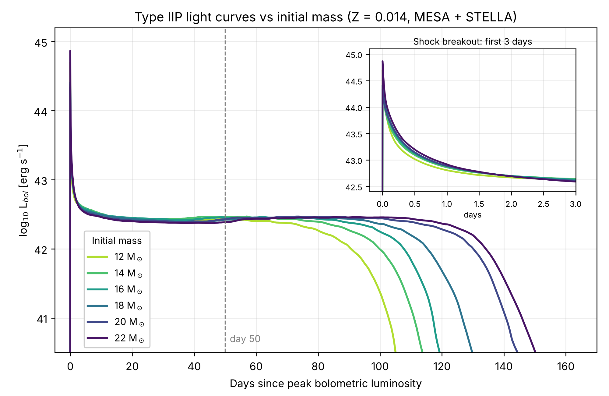
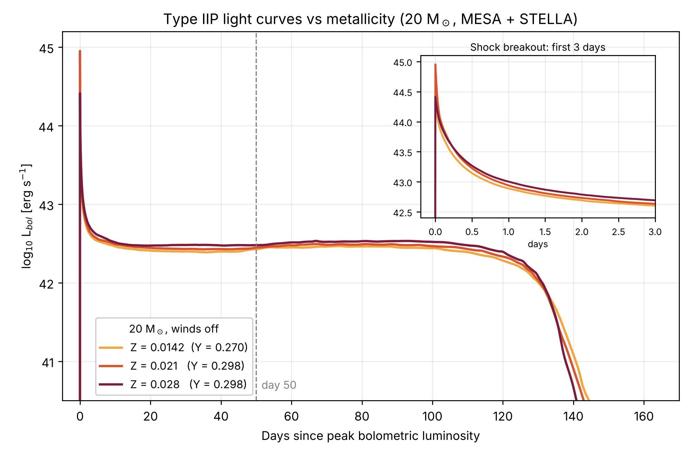

# Modelling Type IIP Supernovae with MESA and STELLA

Undergraduate project, University of Exeter, 2026.
Authors: James Higgins and Blake Nimmo. Supervisor: Pablo-Loren Aguilar.

We use [MESA](https://mesastar.org) (r26.4.1) to evolve massive stars from the pre-main sequence to core collapse, explode them with MESA's `ccsn_IIp` test case, and calculate bolometric light curves with STELLA. We compare how the plateau of a Type IIP supernova changes with initial mass and metallicity.



## Runs

All runs: winds off (`Dutch_scaling_factor = 0`), no rotation, Asplund et al. (2009) abundance mix, ⁵⁶Ni mass effectively zero (`x_ctrl(12) = 1d-15`), so the light curves have a plateau but no radioactive tail.

| Run | Initial mass | Z | Y | Pre-collapse folder | Explosion folder | Handoff to STELLA |
|---|---|---|---|---|---|---|
| 12M | 12 M☉ | 0.0142 | 0.2703 | `12M_pre_ms_to_core_collapse` | `ccsn_IIp_12M` | 0.05 M☉ below surface |
| 14M | 14 M☉ | 0.0142 | 0.2703 | `14M_pre_ms_to_core_collapse` | `ccsn_IIp_14M`† | 0.05 M☉ below surface |
| 16M | 16 M☉ | 0.0142 | 0.2703 | `16M_pre_ms_to_core_collapse` | `ccsn_IIp_16M` | 0.05 M☉ below surface |
| 18M | 18 M☉ | 0.0142 | 0.2703 | `18M_pre_ms_to_core_collapse` | `ccsn_IIp_18M`† | 0.06 M☉ below surface* |
| 20M | 20 M☉ | 0.0142 | 0.2703 | `20M_pre_ms_to_core_collapse` | `ccsn_IIp_20M` | 0.05 M☉ below surface |
| 22M | 22 M☉ | 0.0142 | 0.2703 | `22M_pre_ms_to_core_collapse` | `ccsn_IIp_22M` | 0.13 M☉ below surface* |
| 20M_1.5Z | 20 M☉ | 0.021 | 0.2979** | `20M_Z0.021` | `ccsn_IIp_20M_1.5Z` | ~0.12 M☉ below surface* |
| 20M_2Z | 20 M☉ | 0.028 | 0.2979 | `20M_Z0.028` | `ccsn_IIp_20M_2Z` | 0.05 M☉ below surface |

\* The shock stalled near the stellar surface in MESA (tiny timesteps, constant `get_T_tau` retries), so the model was handed to STELLA earlier than normal (`x_ctrl(16)` raised in `inlist_shock_part5`, and for 22M also set in `inlist_shock_part4`). See `LAB_BOOK.md`.
† `max_model_number` in `inlist_infall` raised from 500 to 3000: the 14 M☉ core collapses more slowly and ran out of infall steps. Numerical limit only; the 18M folder was copied from the 14M one so carries the same setting.
\** Helium was not rescaled for Z = 0.021; with ΔY/ΔZ ≈ 2 it would be Y ≈ 0.284.

## Results so far

Plateau length grows steadily with initial mass (all at Z = 0.0142, winds off). Day at which log L_bol drops below 42.0:

| Mass | 12 M☉ | 14 M☉ | 16 M☉ | 18 M☉ | 20 M☉ | 22 M☉ |
|---|---|---|---|---|---|---|
| Plateau end (day) | 91.6 | 99.8 | 108.5 | 115.5 | 130.3 | 134.2 |

All six plateaus have the same brightness (log L ≈ 42.4–42.5 at day 50). Changing metallicity from Z = 0.0142 to 0.028 at 20 M☉ makes almost no difference to the plateau, as expected with winds switched off.



## Repository layout

```
LAB_BOOK.md               session-by-session lab book, with the commands used
plot_lightcurve.py        plots one or more light curves from lightcurves/<run>/
plot_mass_comparison.py   mass-series figure with breakout inset (--full for whole range)
plot_metallicity_comparison.py  metallicity-series figure, same style
plots/                    light curve figures
lightcurves/<run>/
    mesa.lbol_lnuc.txt    bolometric light curve: days after peak, log L_bol, log L_nuc
    mesa.tt               STELLA multi-band light curve output
    mesa.hyd, mesa.abn    MESA structure and composition handed to STELLA
runs/pre_collapse/<folder>/   inlists, rn script and source for the evolution to core collapse
runs/explosion/<folder>/      inlists, rn script and source for the explosion (ccsn_IIp)
```

MESA's raw outputs (`.mod` files, `LOGS`, `photos`, `png` frames) are not included because of their size.

## Reproducing a run

1. Install MESA r26.4.1 and the MESA SDK, and set up the environment:
   ```
   export MESASDK_ROOT=/Applications/mesasdk
   source $MESASDK_ROOT/bin/mesasdk_init.sh
   export MESA_DIR=/path/to/mesa
   export OMP_NUM_THREADS=4
   ```
2. Copy a folder from `runs/pre_collapse/` into `$MESA_DIR/star/test_suite/` and run `./clean && ./mk && ./rn`. This produces `final.mod`.
3. Copy the matching `runs/explosion/` folder into the test suite, copy `final.mod` into it as `pre_ccsn.mod`, then `./clean && ./mk && ./rn`. This writes `mesa.hyd` and `mesa.abn`.
4. Copy `mesa.hyd` and `mesa.abn` into `$MESA_DIR/stella/modmake/`, remove `stella/strad/run/stop` if it exists, and run `./rn` in `$MESA_DIR/stella`. Results appear in `stella/res/`.

## Plotting

Run `plot_lightcurve.py` from the repository folder. It reads `lightcurves/<run>/mesa.lbol_lnuc.txt` (falling back to a local `stella/res_<run>` folder) and saves the figure next to the script. Examples:

```
python plot_lightcurve.py 22              # one run
python plot_lightcurve.py 12 16 20 22     # mass series
python plot_lightcurve.py 20M 20M_1.5Z 20M_2Z   # metallicity series
```
